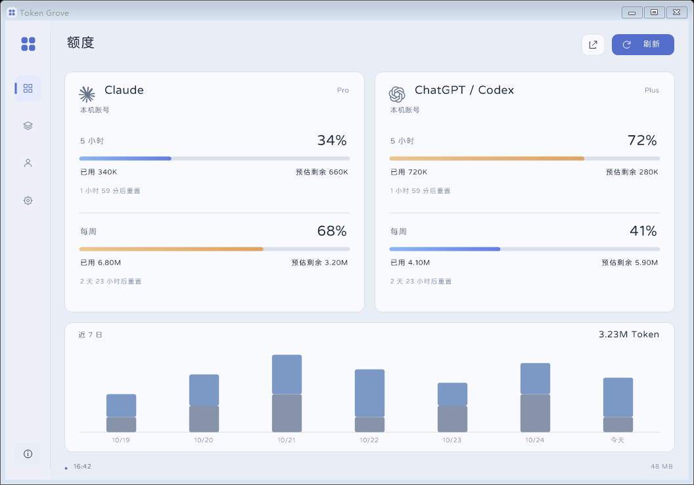
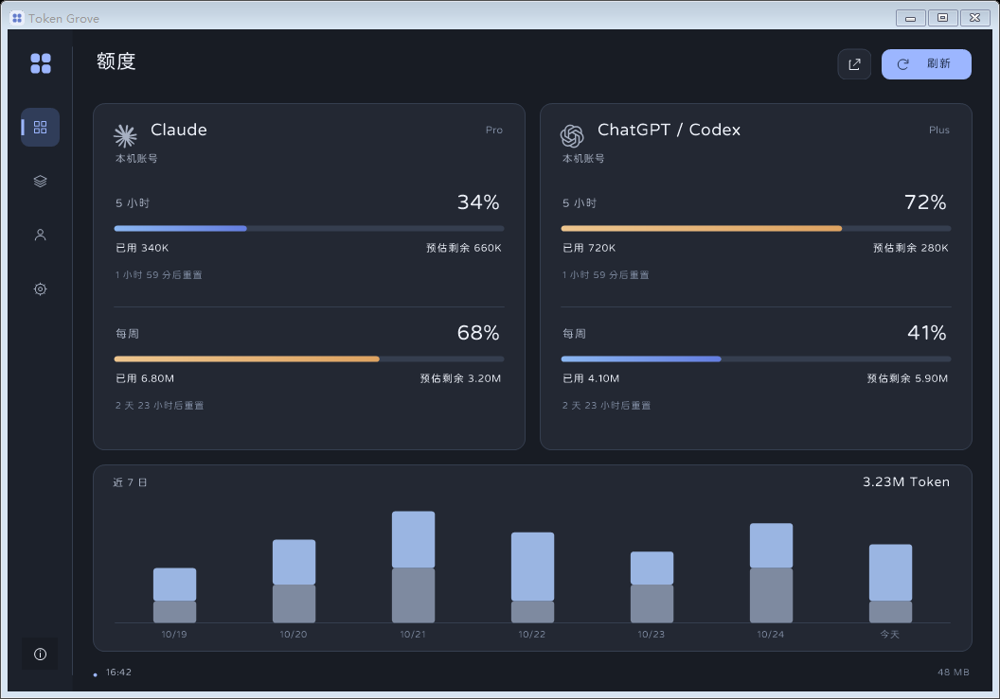

# Token Grove

轻量 Windows 原生 Claude / Codex 账号额度与 Token 用量工具。

[下载 Windows 便携版](https://github.com/XiGuaOhh/token-grove/releases/latest) · [使用说明](docs/使用说明.md) · [更新记录](CHANGELOG.md)



## 功能

- 自动读取本机已登录 Claude Desktop / Claude Code、Codex 的额度。
- 展示 5 小时与周额度的百分比、重置时间、本机 Token 用量和独立预估余量。
- 按日期、分钟、客户端及模型查询历史，查看趋势、每日汇总与分页记录，导出 CSV。
- 328 × 116 悬浮窗、系统托盘、置顶、亮暗主题及 Windows 11 毛玻璃；主窗口、内容底板和悬浮窗分别调节不透明度。
- 原生 WinForms / GDI+，没有浏览器内核、常驻 Node 服务或持续动画。

预览使用合成演示数据，不包含真实账号或使用记录。

<details>
<summary>深色预览</summary>



</details>

## 运行

需要 Windows 10 / 11 x64 和 .NET Framework 4.8。解压 Release 中的便携包，运行 **Token Grove.exe**；请保留同目录的 **fonts** 文件夹。Windows 11 22H2 及以上支持系统 Acrylic 毛玻璃，其他环境使用普通背景。

默认显示悬浮窗：拖动移动、双击返回原页面、右键菜单。关闭主窗口会转入悬浮窗，完全退出请使用托盘菜单。开机启动默认关闭。

在设置中开启毛玻璃后，可调节 **内容底板不透明度（35%–100%）**，改变卡片、设置、用量、趋势和表格的背景，文字与数据保持清晰。

**ChatGPT 栏显示 Codex 订阅额度，不代表 ChatGPT 网页各模型的消息限制。** Token 统计只覆盖本机可读日志；网页端、其他设备和已删除的记录不在统计范围内。预估余量不是官方 Token 余额，窗口或样本不足时显示“—”。

## 构建与检查

需要 Windows、.NET Framework 4.8 和 .NET SDK。

```powershell
./build.ps1
$test = Start-Process './Token Grove.exe' -ArgumentList '--self-test' -Wait -PassThru -NoNewWindow
if ($test.ExitCode -ne 0) { throw 'Self-tests failed' }
./scripts/package.ps1
```

Windows 桌面环境下的 58 项原生检查覆盖加密校验、增量日志、去重、时间范围、缓存计数、额度窗口、5 小时及每周预估、快照兼容、字体平滑、悬浮窗恢复和透明度。无 DWM 的构建环境跳过两项系统合成检查。检查使用本地合成夹具，无需登录账号。

便携包与 SHA-256 校验文件生成于 `dist/`。构建不会扫描账号，测试不会读取真实聊天日志。运行程序后的同步才会读取本机客户端状态。

## 本机数据

偏好和摘要保存在 `%LOCALAPPDATA%\TokenGrove`。程序只使用客户端已有授权读取额度，不读取浏览器 Cookie、不刷新或改写登录、不导出令牌。兼容接口可能随客户端更新而变化，不可用时显示缓存来源或未知状态。

## 第三方资源

圆体源自寒蝉全圆体，按 SIL OFL 1.1 分发；客户端图标源自 Lobe Icons，采用 MIT 许可。见 [第三方声明](THIRD_PARTY_NOTICES.md)。本项目与 Anthropic、OpenAI 没有隶属或背书关系。
